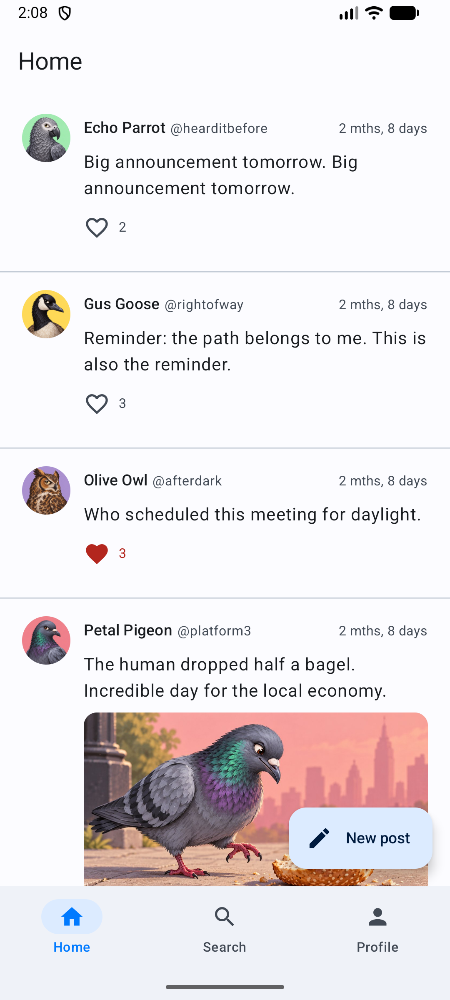

# Chirpy

A little social network for the flock. Chirpy is a native **iOS and Android** demo where birds share updates, collect likes, and occasionally find a bagel.

Built with **SwiftUI** on iOS and **Kotlin + Jetpack Compose** on Android, both apps share a Supabase backend. It’s a small, hands-on project for exploring native app development.

<table>
  <tr>
    <th align="center">iOS</th>
    <th align="center">Android</th>
  </tr>
  <tr>
    <td align="center"></td>
    <td align="center"></td>
  </tr>
</table>

## Meet the flock

- Browse bird posts and photos, with more loading as you scroll.
- Search posts, explore the demo profile, and open posts for a closer look.
- Like your favorites, write a text post, or delete one of your own.
- Pull to refresh and catch up on the latest chatter.

Both apps use a **shared demo profile**—there’s no sign-up or individual account.

## Getting started

Clone the repository, then choose your platform:

```sh
git clone https://github.com/samyanez94/Chirpy.git
```

Both apps connect to the hosted demo backend by default. You’ll need its configured Chirpy API key, or you can [run your own backend](https://github.com/samyanez94/Chirpy/wiki/Backend#run-the-backend-locally).

Use the dedicated Chirpy key, never a Supabase service-role key. Local key files are Git-ignored; the key is bundled into your app build.

### iOS

You’ll need **Xcode with support for iOS 26.5 or later** and an iPhone simulator or device.

1. Copy the configuration template:
   ```sh
   cp ios/Configuration/LocalConfiguration.example.plist ios/Chirpy/LocalConfiguration.plist
   ```
2. Set `ChirpyAPIKey` in the copied file to your backend’s Chirpy API key.
3. Open `ios/Chirpy.xcodeproj`, select the **Chirpy** scheme and an iPhone simulator, then run.
   For a physical device, configure signing in Xcode first.

Using your own backend? Update `baseURL` in [AppConfiguration.swift](ios/Chirpy/AppConfiguration.swift).

### Android

You’ll need **Android Studio**, **Android SDK Platform 37.0**, and **Build Tools 36.0.0**. Run on an emulator or device with **Android 8.0 (API 26) or later**.

1. Copy the configuration template:
   ```sh
   cp android/chirpy.properties.example android/chirpy.properties
   ```
2. Set `CHIRPY_API_KEY` in the copied file. Set `CHIRPY_BASE_URL` too if you’re using your own backend.
3. Open the `android/` directory in Android Studio, sync Gradle, and run the **app** configuration.

See the [Wiki development guide](https://github.com/samyanez94/Chirpy/wiki/Development#run-android) for Java requirements, local backend settings, and test commands.

## Learn more

Visit the [Chirpy Wiki](https://github.com/samyanez94/Chirpy/wiki) for app background, architecture, and backend documentation. For local test commands and CI details, see the
[Wiki development guide](https://github.com/samyanez94/Chirpy/wiki/Development).
