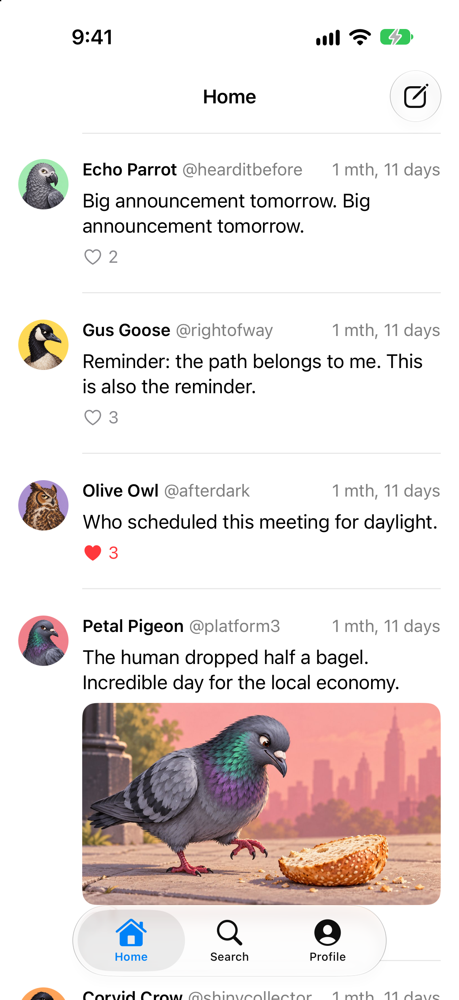

# Chirpy

Chirpy is a native iOS social-feed demo where birds post about life in the flock. It is a sandbox for SwiftUI,
concurrency, networking, pagination, and testing.

<p align="center">
  
</p>

## Features

- Browse a reverse-chronological feed of bird posts
- View the current profile and its posts
- Load more posts as you scroll
- Open a post to see its full text, image, and timestamp
- Create text-only posts
- Like and unlike posts
- Refresh with pull-to-refresh

Chirpy uses a shared demo profile for posts and likes. It does not require an account.

The Search tab supports [paginated post search](https://github.com/samyanez94/Chirpy/wiki/Backend#search).

## Built With

- Swift and SwiftUI
- Observation and Swift concurrency
- URLSession for networking
- Supabase Postgres, Storage, and Edge Functions
- Swift Testing and Deno tests

The iOS project targets iOS 26.5 or later. Both clients share the backend in this repository.
The Android client is under development; its first slice implements the Home feed.

## Repository Structure

```text
Chirpy/
├── ios/
│   ├── Chirpy.xcodeproj
│   ├── Chirpy/              # App sources and assets
│   ├── ChirpyTests/         # Tests and fixtures
│   ├── Configuration/      # Local configuration template
│   └── .swift-format
├── android/                # Native Android client and Gradle build
├── supabase/               # Shared backend, tests, and demo data
│   ├── deno.json           # Backend tasks and tooling
│   └── deno.lock
└── docs/                   # Shared documentation assets
```

Each client owns its platform-specific code and build configuration. Backend Deno tooling lives in `supabase/`.

## Running the Project

1. Clone the repository.
2. Copy `ios/Configuration/LocalConfiguration.example.plist` to `ios/Chirpy/LocalConfiguration.plist`.
3. Set `ChirpyAPIKey` in the copied file to the personal API key configured on the backend.
4. Open `ios/Chirpy.xcodeproj` in a compatible Xcode version and select the `Chirpy` scheme.
5. Choose an iPhone Simulator or configure signing for your device, then build and run.

The app connects to the hosted Supabase project by default. You need its configured API key, or you can run your own
backend using the [backend guide](https://github.com/samyanez94/Chirpy/wiki/Backend). Keep the personal key private;
never use a Supabase service-role key in the app.

To run the iOS tests from the repository root, choose an installed simulator and run:

```sh
xcodebuild test -project ios/Chirpy.xcodeproj -scheme Chirpy \
  -destination 'platform=iOS Simulator,name=<simulator name>'
```

For Android setup, architecture, and verification commands, see [the Android README](android/README.md).

## Backend Development

Run the Deno tasks from `supabase/`:

```sh
cd supabase
deno task verify      # Type checks, lint, unit tests, and demo validation
deno task test:db     # SQL integration tests against the running local stack
deno task check       # Type-check Edge Functions and the seed generator
deno task test        # Run the social-feed tests
deno task demo:build  # Regenerate local demo SQL files
deno task demo:check  # Validate demo assets and generated SQL
```

From the repository root, you can also select the configuration explicitly, for example:
`deno task --config supabase/deno.json test`.

Continue running Supabase CLI commands and `sh supabase/scripts/publish_bird_demo.sh` from the repository root.
The demo build task only generates local files; publishing is a separate step.

## Continuous integration

GitHub Actions validates all three projects on every pull request, push to `main`, and manual run.
New pushes cancel superseded runs for the same workflow and branch. CI uses no production secrets
and does not deploy the backend or publish apps.

| Required check | Validation | Local equivalent |
| --- | --- | --- |
| Supabase validation | Type checks, lint, unit tests, demo data, fresh migrations/seed, SQL integration tests | In `supabase/`: `deno task verify`, then `deno task test:db` against a running local stack |
| iOS validation | Swift formatting, simulator tests, Release compilation | Commands below |
| Android validation | Formatting, detekt, lint, JVM tests, debug and optimized Release APKs | In `android/`: `./gradlew fullValidation` |
| Android UI tests | Compose tests on an API 35 emulator | In `android/`: `./gradlew connectedDebugAndroidTest` |

For iOS, from the repository root:

```sh
xcrun swift-format lint --strict --recursive ios/Chirpy ios/ChirpyTests
xcodebuild test -project ios/Chirpy.xcodeproj -scheme Chirpy \
  -destination 'platform=iOS Simulator,name=<simulator name>' CODE_SIGNING_ALLOWED=NO
xcodebuild build -project ios/Chirpy.xcodeproj -scheme Chirpy \
  -configuration Release -destination 'generic/platform=iOS Simulator' CODE_SIGNING_ALLOWED=NO
```

CI selects Xcode 26.6 with an iOS 26.5 simulator. Backend tooling is pinned to Deno 2.9.5
and Supabase CLI 2.115.0. Android uses JDK 17 for SDK tools and analysis; Gradle automatically
provisions JetBrains JDK 25 according to its committed daemon criteria. Action revisions are pinned.

Test/analysis reports and failure diagnostics are available as workflow artifacts for seven days.
The iOS tests use stubbed clients; CI omits the optional local API-key configuration. Backend SQL
tests run only against the ephemeral local database. Client tests do not require a hosted backend.

Require the four checks above in the `main` branch protection settings after their first successful
runs. Workflow files alone do not enforce merge restrictions. Keep required workflows running on
all pull requests; adding path filters can leave required checks pending.

## Documentation

- [App Overview](https://github.com/samyanez94/Chirpy/wiki/App-Overview) — app behavior, the bird demo, and current
  limits.
- [Architecture](https://github.com/samyanez94/Chirpy/wiki/Architecture) — state, networking, and the backend.
- [Development](https://github.com/samyanez94/Chirpy/wiki/Development) — run and test the iOS app.
- [Backend](https://github.com/samyanez94/Chirpy/wiki/Backend) — Supabase setup, API reference, tests, and deployment.
